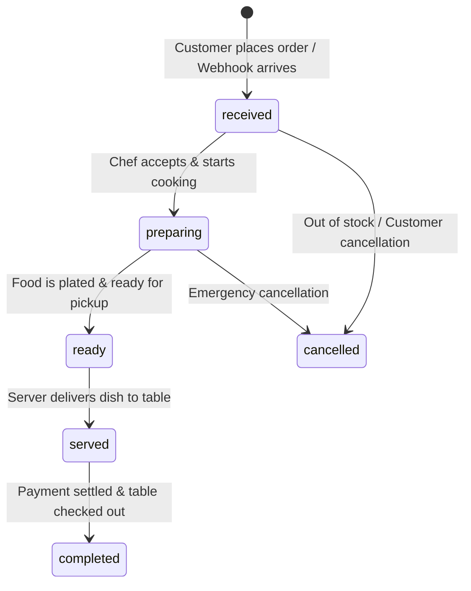

# Section 2.4: Kitchen Display System (KDS) & Order Lifecycle

[← Table QR & Session Lock](file:///Users/abhijeethkar/Desktop/menudot-backend/docs/02-realtime-workflows/03-table-qr-session-management.md) | [Next: Aggregator Integrations →](file:///Users/abhijeethkar/Desktop/menudot-backend/docs/02-realtime-workflows/05-aggregator-integrations.md)

---

## 1. Kitchen Order State Machine

Every order (Dine-in or Delivery Aggregator) transitions through a deterministic state machine:

---

## 2. Real-Time Order Execution Steps

### Step 1: Order Placement & WebSocket Broadcast
- **API Trigger**: `POST /api/v1/orders`
- **System Action**:
  - Calculates items subtotal, GST tax, packing charges, platform fee, and final amount.
  - Inserts document into `orders` collection with status `received`.
  - Dispatches WebSocket event `order_created` to Socket.io room `restaurant_<restaurantId>`.

### Step 2: KDS Screen Display & Audio Alert
- Chef's Kitchen Tablet receives `order_created` event instantly over WebSocket.
- Renders order card highlighting: Table Number, Order ID, Items, Quantity, Selected Addons, and Special Preparation Instructions (e.g. *"Extra spicy", "No onion"*).

### Step 3: Preparation (`received` → `preparing`)
- Chef taps **Start Preparing** on KDS tablet.
- **API Trigger**: `PATCH /api/v1/orders/:id/status` (`status: 'preparing'`)
- Dispatches `order_updated` WebSocket event.

### Step 4: Food Plated (`preparing` → `ready`)
- Chef finishes cooking and taps **Mark Ready**.
- **API Trigger**: `PATCH /api/v1/orders/:id/status` (`status: 'ready'`)
- Floor waiters receive instant notification on their mobile devices to pick up food from pass.

### Step 5: Served to Table (`ready` → `served`)
- Waiter delivers food to Table T-04 and taps **Mark Served**.
- **API Trigger**: `PATCH /api/v1/orders/:id/status` (`status: 'served'`)

---

[← Table QR & Session Lock](file:///Users/abhijeethkar/Desktop/menudot-backend/docs/02-realtime-workflows/03-table-qr-session-management.md) | [Next: Aggregator Integrations →](file:///Users/abhijeethkar/Desktop/menudot-backend/docs/02-realtime-workflows/05-aggregator-integrations.md)
